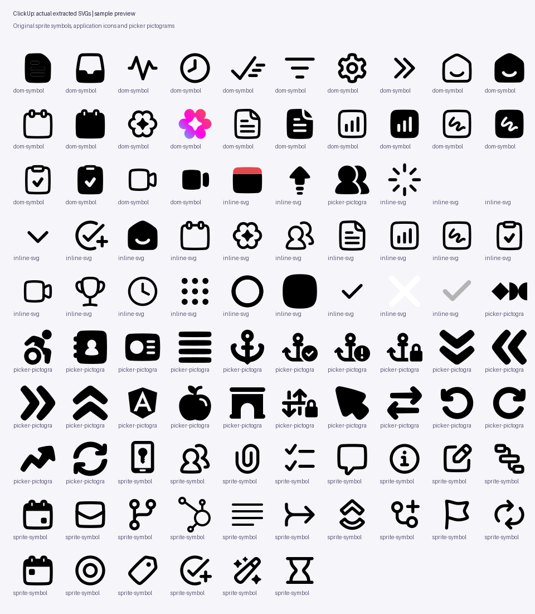

# ClickUp historical case study

This optional example records the original extraction. For the universal workflow, start at the [repository README](../../README.md). The archived ZIP preserves the original exports. The current generic exporter also resolves use instances and standalone original SVGs, so rebuilding with it produces a larger inventory.

# Bulk icon & pictogram extraction workflow

A browser-assisted workflow for collecting original SVGs, sprite symbols and inline pictograms from authenticated web applications, with deduplication, provenance and explicit coverage limits.

This repository contains the **actual ClickUp extraction performed on 15 October 2026**, its portable capture inputs, reusable capture/packaging code and a downloadable result. The capture helper runs inside Codex's browser-control session; this is not an unattended crawler or a standalone browser extension.

## Recorded results

| Measurement | Result |
|---|---:|
| Captured interface states | 74 |
| Distinct final URLs | 49 |
| Deduplicated SVG exports | 2,209 |
| Symbols in original downloaded sprite | 1,321 |
| Unique picker pictograms | 603 |
| DOM symbol exports | 329 |
| Original downloaded image files | 33 |

Source categories overlap. Counts include SVG geometry exports and auxiliary graphics, rather than 2,209 distinct visible interface icons. Validation found 10 exports with unresolved local definitions, one CairoSVG rendering error and 49 fully transparent 64px previews. See the packaged report for the precise boundary of verified assets.

**[Download the actual extraction ZIP](results/clickup-icons-and-pictograms.zip)**. Unzip it and open `clickup-assets/coverage-report.html` or `clickup-assets/gallery.html`. The ZIP contains individual SVGs, the original sprite, raw markup, manifests, coverage records, failure logs and evidence.



## Rebuild using the universal pipeline

From the repository root:

```sh
python3 scripts/run.py --input examples/clickup/data --output build/clickup-example
```

The source captures identify picker SVGs and record loading observations explicitly. Run metadata is stored in `data/run.json`. `finalize_recorded_run.py` is retained only as the historical report-generation script; the supported report generator is `scripts/finalize_run.py` at the repository root.

Original results preserve the extraction limits, incomplete SVGs and renderer observations from the recorded run. Their asset counts differ from new exports that resolve SVG use instances and standalone originals.
